  <strong>English</strong> &nbsp;·&nbsp; <a href="./README.pt-BR.md">Português (BR)</a> &nbsp;·&nbsp; <a href="./README.es.md">Español</a>

# Eduardo Augusto · Eduardo Developer

Full stack developer working with TypeScript, React, Next.js, Node.js, and Go.

  

  

I'm Eduardo. I build fast interfaces and work on making them easy to use.

I specialize in React and Next.js, with an emphasis on type safety and clean code. I'm currently building Versum, a multi-platform Bible reader for reading at your own pace. It has no feed, likes, or rankings.

I also have experience building backends with Hono, Express, and Fastify, and I explore other technologies as new problems come up.

I really enjoy studying Clean Architecture, Hexagonal Architecture, DDD, and TDD.

Available for job opportunities and freelance projects: [contato@eduardoaugusto.work](mailto:contato@eduardoaugusto.work) 
Portfolio: [eduardoaugusto.work](https://eduardoaugusto.work/)

## 

### Versum - Multi-platform Bible reader

Read the whole Bible at your own pace, without a feed, likes, or rankings. Magic-link auth, progress synced across devices, offline reading on Android, and chapter/verse sharing.

Tech:
- Backend: Go, PostgreSQL, Redis
- Web: Next.js (planned)
- Mobile: React Native / Expo (planned)
- Status: Pre-alpha. Architecture and product defined, implementation starting with the biblical corpus

GitHub: [Versum Repository](https://github.com/eduardoaugustolb/versum)

### Affiliate Hub - Frost Drops

End-to-end automation for a streetwear and fragrance affiliate profile: syncs products and links (Shopee, Shein, Mercado Livre), auto-generates post images, and distributes new products to a WhatsApp group.

Tech:
- Language: TypeScript
- Runtime: Bun
- Architecture: Clean Architecture + Hexagonal (Ports & Adapters)
- Status: In progress. Auth and product catalog modules already implemented

GitHub: [Affiliate Hub Repository](https://github.com/eduardoaugustolb/affiliate-hub)

## 

### Frontend (main specialty)
- Frameworks: Next.js 16, React 19
- Language: TypeScript (type-safe)
- Styling: Tailwind CSS, CSS3, HTML5, JavaScript
- Focus: Performance, UX/UI, Responsiveness

### Backend (actively developing)
- Runtimes: Node.js, Bun
- Frameworks: Hono.js, Express, Fastify
- Databases: PostgreSQL, Redis
- ORM: Drizzle ORM
- Currently learning: Go (beginner)

### Tools and workflow
- Editors: Zed, VS Code
- Version Control: Git, GitHub
- Package Managers: Bun, npm
- Environment: Linux (Omarchy)

## 

I optimize Core Web Vitals and work on the user experience. Type safety in TypeScript helps me reduce bugs, and I aim to keep the code clean, maintainable, and scalable.

I work with Next.js 16, Hono, Bun, and React 19, covering both frontend and backend when needed. During a project, I send regular updates and stay available to discuss the work.

## 

## 

I can help with:
- Next.js development
- APIs with Hono, Express, Fastify
- Web performance optimization

> Have a project in mind? Send me the details.
> [contato@eduardoaugusto.work](mailto:contato@eduardoaugusto.work)

[discord](https://discord.com/users/909580127644549201) &nbsp;·&nbsp;
[youtube](https://www.youtube.com/@eduardo.developer) &nbsp;·&nbsp;
[instagram](https://www.instagram.com/eduardoaugustolb/)
